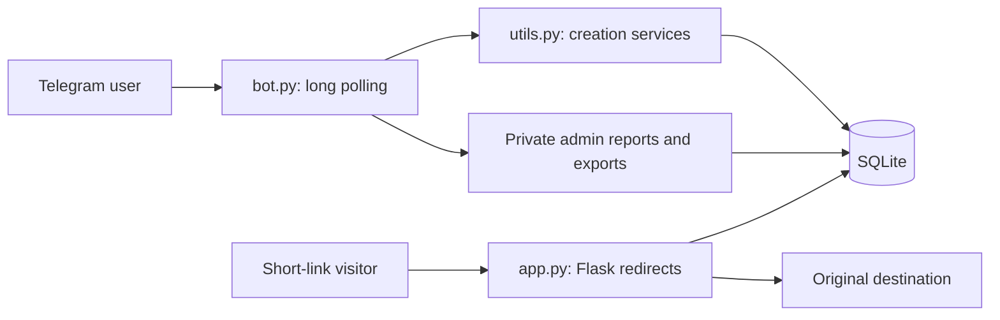

# URL Shortener & Campaign Analytics

A general-purpose Telegram-based URL shortener and campaign analytics tool with
expiring short links, UTM campaign tracking, click analytics, administrator
reporting, and secure CSV exports. Users can manage their own links privately;
analytics, reports, and exports are restricted to authorized administrators.

Built as an independent Python portfolio project. The code is prepared for a
separate deployment stage; no public production deployment, traffic, or company
adoption is claimed. The public project title is independent of the existing
Telegram bot identity; its username, token, and displayed name remain unchanged.

[Quick start](#quick-start) · [Architecture](#architecture) ·
[Commands](#telegram-commands) · [Security](#security-and-privacy) ·
[Deployment guide](DEPLOYMENT.md) · [Release review](RELEASE_CHECKLIST.md)

## Features

- Random short codes with case-insensitive uniqueness and collision retries.
- Per-user duplicate reuse without changing the existing link's expiration.
- Inline expiration choices: Never, 24 Hours, 7 Days, 30 Days, or Custom Date.
- A private **My Links** view showing the user's latest 10 links.
- Atomic click counters and individual click-event recording.
- Daily UTC reporting, destination UTM attribution, device/OS summaries, and
  heuristic bot classification.
- A private administrator dashboard with authenticated sender checks on every
  protected command and callback.
- Six CSV export types with date filters, formula-injection protection, explicit
  truncation notices, UTF-8 BOM encoding, and temporary-file cleanup.
- Safe Telegram HTML, copy/open navigation, generic user errors, and sanitized logs.

Backend custom-alias creation is available through Python services; there is no
Telegram custom-alias workflow. Unique-visitor identification, country detection,
and reporting through public HTTP endpoints are not implemented.

## Technology stack

| Component | Role |
| --- | --- |
| Python | Application and standard-library parsing/report generation |
| Flask | Public redirects and a basic liveness endpoint |
| SQLite | Users, links, counters, and click events |
| python-telegram-bot 22.8 | Telegram commands, inline callbacks, and long polling |
| HTTPX | PTB transport, environment proxies, and configured network timeouts |
| unittest | Offline unit and SQLite/Flask integration tests |

**Tested runtime:** CPython 3.14.4. Current dependencies declare Python 3.10 or
newer as their combined minimum, but other Python versions have not been
validated by this project's release run. `requirements.txt` declares runtime
requirements; `requirements.lock` pins the complete installed runtime dependency
closure used for testing. Neither file constitutes a vulnerability audit.

## Architecture



The bot and Flask server are separate processes sharing one database file.

| Module | Responsibility |
| --- | --- |
| `bot.py`, `bot_ui.py` | Public workflows, expiration selection, and presentation |
| `authorization.py` | Environment allowlist and private-chat authorization |
| `telegram_reports.py`, `telegram_exports.py` | Owned links and protected reports/export flows |
| `utils.py`, `validators.py` | Link creation, validation, normalization, duplicate policy |
| `database.py` | Schema initialization, parameterized queries, transactions, analytics |
| `utm.py`, `user_agent.py`, `referrer.py` | Destination tags and normalized request metadata |
| `csv_reports.py` | Bounded, formula-safe CSV generation |
| `configuration.py`, `operational_errors.py` | Environment validation and safe error handling |

### Telegram workflow

1. Send one HTTP/HTTPS URL or choose **Shorten URL**.
2. Choose an expiration; no link is created before selection.
3. For a custom date, enter a future timezone-aware value such as
   `2099-01-01 12:00 +03:30`. Accepted values normalize to UTC.
4. Receive the short URL, current status, and **actual stored** expiration.
   Reused links explicitly retain their original expiration.

`/cancel` cancels pending link/export selection. A new URL replaces a pending
URL. State is isolated by user/chat, guarded by selection IDs, and expires after
30 minutes when the next interaction is processed. State is memory-only and is
lost on restart. Keep one sequential polling instance per token.

### Redirects and click recording

`GET /` returns a fixed liveness message. `/<short_code>` resolves codes
case-insensitively: eligible links return **302**, missing codes **404**, and
inactive/expired/invalid-expiration links **410**. Recording failures return
**503**, without a successful redirect. Flask's implicit HEAD requests follow
the same existing recording behavior.

For an eligible request, one SQLite transaction increments `click_count`, updates
`last_click_at`, and inserts one event with the same UTC timestamp. Each update
commits completely or rolls back. Historical counters and event counts are
reported separately; missing historical events are never invented.

## Telegram commands

| Command | Access |
| --- | --- |
| `/start`, `/help`, `/cancel` | Public menu, instructions, cancellation |
| `/mylinks` | Private chat; latest 10 links owned by the authenticated user |
| `/admin` | Private administrator dashboard |
| `/overview` | Admin inventory, historical counters, and classified event totals |
| `/stats <short_code>` | Admin inspection of any link |
| `/daily` | Admin last 7 UTC days, including explicit zero-event days |
| `/campaigns` | Admin top 5 tagged combinations, with Untagged and overall totals |
| `/devices` | Admin device and OS event summaries |
| `/alllinks` | Admin latest 10 links, without unnecessary owner information |
| `/export` | Admin CSV type and date-range selection |

All administrative commands, callbacks, custom export inputs, and document
delivery require an allowlisted Telegram sender in a private chat. A hidden
button is not an authorization boundary. Ordinary users receive no analytics.

## CSV exports and analytics definitions

Exports cover **Overview, Links, Daily Analytics, UTM Analytics, Device/OS
Analytics, and Click Events**. Choose Today, Last 7 Days, Last 30 Days, or two UTC
calendar dates (`YYYY-MM-DD YYYY-MM-DD`). Start is inclusive; end is exclusive.
Custom ranges are limited to 366 days.

- Events and aggregates filter by event time; Links filters by link creation.
- Overview inventory/counters remain all-time and are labeled accordingly.
- CSV daily reports omit empty days; Telegram daily presentation fills zeros.
- Each export stops at **5,000 data rows or 8 MiB**, with an explicit TRUNCATED
  caption when either limit applies. No report is published at a public URL.
- Files use UTF-8 with BOM and ISO 8601 UTC timestamps. NULL cells are empty.
  Formula-like string cells receive a protective apostrophe; stored data is unchanged.
- Database readers and temporary files close on success or failure. PTB uploads
  use an explicitly named `InputFile` to support spooled files safely.

UTM extraction reads the stored destination, not redirect query parameters or
referrers. Exact case-sensitive keys are decoded once; values retain case and
whitespace. The first well-formed occurrence wins, including an empty value
(which becomes NULL). Missing values become NULL; malformed escapes, invalid
UTF-8, and fields without `=` are ignored. Fragments are not query parameters.
Tags describe destination labels, not proven acquisition sources.

## Security and privacy

- Authorization uses `update.effective_user.id`, never usernames or claimed IDs.
  Missing administrator configuration denies everyone; malformed lists stop startup.
- Link ownership is resolved server-side. `/mylinks` accepts no owner override.
- Only normalized device/OS/bot fields and referrer origins are retained; no raw
  client IP, complete User-Agent, or visitor fingerprint is collected.
- Bot classification is heuristic: known bot, likely non-bot, or uncertain.
- HTTP/HTTPS validation rejects credentials, IP literals, malformed domains, and
  unsafe schemes under the current policy. It is not a reputation/DNS filter.
- HTML output escapes dynamic values; CSV output neutralizes formula markers.
- Error messages are generic; operational logs omit exception payloads, user IDs,
  tokens, private URLs, and report contents. Infrastructure logs require separate
  privacy configuration.
- Databases, exports, logs, virtual environments, and secret files are ignored by
  Git. Do not force-add runtime data. Screenshots must use synthetic data.

See [release findings](RELEASE_CHECKLIST.md) for completed offline checks and
explicit audit limitations. A heuristic secret scan is not proof that no secret
exists, and dependency compatibility is not a vulnerability assessment.

## Quick start

### 1. Install

Clone your reviewed repository URL; this placeholder is not an existing remote:

```bash
git clone <your-reviewed-repository-url> telegram-url-shortener-bot
cd telegram-url-shortener-bot
python3.14 -m venv .venv
.venv/bin/python -m pip install -r requirements.lock
.venv/bin/python -m pip check
```

The lock reflects the tested environment; clean online installation and live
advisory resolution must be verified before publishing a release/deploying.
Do not install packages from untrusted mirrors or publish proxy credentials.

### 2. Configure explicitly

```bash
cp .env.example .env
chmod 600 .env
# Edit .env locally; replace the token placeholder and set your own admin IDs.
# Source only your trusted local file; Python does not auto-load .env.
set -a
. ./.env
set +a
.venv/bin/python database.py
```

Use a token obtained for your own bot. Administrator IDs are positive numeric
Telegram user IDs separated by commas; usernames are not accepted. Never paste
real values into source code, screenshots, issue reports, or Git commands.

| Variable | Local configuration | Production |
| --- | --- | --- |
| `APP_ENV` | `development` | Explicit `production` |
| `TELEGRAM_BOT_TOKEN` | Replace the placeholder | Protected service environment |
| `TELEGRAM_ADMIN_IDS` | Blank denies admin access | Your own reviewed numeric allowlist |
| `BASE_URL` | `http://127.0.0.1:5000` | Explicit public HTTPS origin |
| `DATABASE_PATH` | `./url_shortener.db` | Absolute persistent path shared by both processes |
| `FLASK_DEBUG` | `0` | Must remain disabled |
| `HTTPS_PROXY`, `ALL_PROXY` | Optional; blank by default | Deliberately configured or removed |
| `HTTP_PROXY`, `NO_PROXY` | Optional transport controls | Review routing and bypasses |

### 3. Run both processes

Terminal 1, with the configuration loaded:

```bash
.venv/bin/python app.py
```

Terminal 2, from the same project directory, load the same trusted environment:

```bash
set -a
. ./.env
set +a
.venv/bin/python bot.py
```

Send `/start` in Telegram, then a URL. Flask must be running for short links to
redirect. **Localhost links are not publicly accessible:** on another device,
`127.0.0.1` refers to that device. No Open Link button is shown for local/private
origins. Copy Link remains available on compatible Telegram clients.

## Running tests

Tests are offline; no bot startup or Telegram API calls are required. Some legacy
mocked tests still open the working-directory database. Remove inherited runtime
settings and isolate the full suite:

```bash
project_dir="$PWD"
test_dir=$(mktemp -d)
(
  cd "$test_dir" || exit 1
  env -u DATABASE_PATH -u TELEGRAM_BOT_TOKEN -u TELEGRAM_ADMIN_IDS \
    -u BASE_URL -u APP_ENV -u FLASK_DEBUG \
    PYTHONPATH="$project_dir" "$project_dir/.venv/bin/python" -B \
    -m unittest discover -s "$project_dir/tests" -v
)
# Remove this temporary directory manually after review if desired.
```

The release run contains **207 passing tests**, covering creation, duplicates,
expiration, redirects, concurrency/rollback, analytics, authorization/ownership,
CSV generation/delivery, safe errors, and production configuration. Tests use
mocked Telegram objects and temporary SQLite fixtures. Counts are release-run
results, not a hosted CI badge or claim about untested environments.

## Screenshots

See [screenshots/README.md](screenshots/README.md) for the real-capture plan and
redaction checklist. No fabricated screenshots or real user analytics are included.

## Known limitations

- No unique visitors, GeoIP, Telegram custom aliases, or public reporting API.
- Lists are limited to 10 entries; campaign UI shows five tagged groups; no pagination.
- Heuristic classification can be spoofed. Counters include previews/bots/HEAD.
- SQLite serializes writes; grouping can scan data and briefly block bot updates.
- Report date comparisons have SQLite millisecond precision. Legacy malformed
  expiration rows need audit; eligibility checks precede the click write transaction.
- Public short links are not access control for confidential destinations.
- Rate limiting, quotas, event retention, and abuse operations need deployment work.
- Pending flows are not durable. DNS/TLS/availability and production load are unverified.

## Production and future organization deployments

[DEPLOYMENT.md](DEPLOYMENT.md) covers Linux services, WSGI/Nginx/TLS, protected
configuration, database persistence, backup/restore, health checks, restart,
rollback, monitoring, and troubleshooting. It is a guide, not evidence of deployment.

A later organization deployment should use a separate bot token/username,
administrator allowlist, persistent database, hostname, and service environment.
Do not copy portfolio users or events. Review branding, ownership, retention, and
organizational security requirements separately; no company branding is added here.

## Publication and licensing

[RELEASE_CHECKLIST.md](RELEASE_CHECKLIST.md) contains the release gate, portfolio
metadata suggestions, and the historical v1.0.0 publication procedure. The
existing v1.0.0 tag is preserved during documentation and branding updates. The
existing Git remote, branch, commit authors, and history are preserved. Git
references record the publication result; no production deployment is implied.

No license has been selected or added. Public source availability alone does not
grant reuse rights. Confirm authorship and third-party rights before publication,
then deliberately select a license if desired. This project is not described as
open source without that decision.
